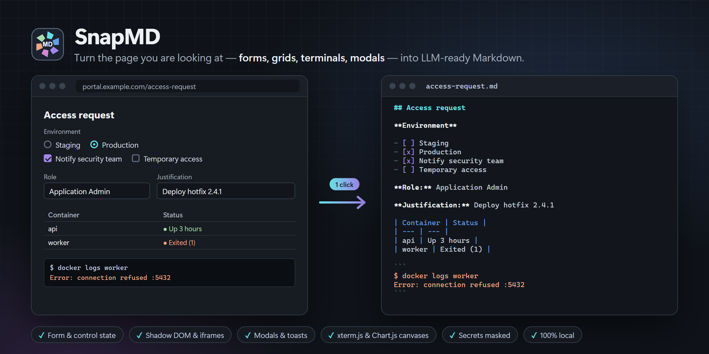
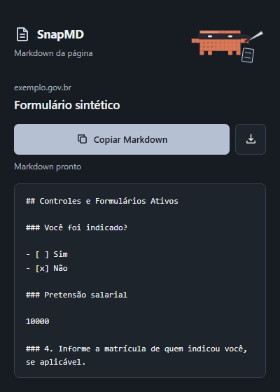

<div align="center">



# SnapMD

**Copy what the page is *doing*, not just what it says.**<br>
A Chrome and Edge extension that turns the page in front of you (form state, grids, terminals, open modals) into clean Markdown you can paste into ChatGPT, Claude or any LLM. No screenshots, and nothing leaves your browser.

[](https://github.com/soulrocha/snapmd/releases/latest)
[](https://github.com/soulrocha/snapmd/actions/workflows/ci.yml)
[](LICENSE)


[Install](#install) · [What it captures](#what-it-captures) · [Privacy](#privacy-and-permissions) · [Limitations](#limitations) · [Development](#development) · [Português](README.pt-BR.md)

</div>

---

## Why SnapMD?

Most "page to Markdown" tools are article clippers. They run Readability, keep the blog post and throw the rest away. Server-side readers such as Jina or Firecrawl fetch the URL again, so they never see your logged-in session, the tab you clicked, or the modal that is open right now.

That is exactly the context you need when you ask an LLM about an **admin portal, a cloud console, a government form or an internal dashboard**. SnapMD reads the live DOM you are looking at and writes down its **state**:

| You see | SnapMD writes |
| --- | --- |
| A checked radio or checkbox | `- [x] Production` / `- [ ] Staging` |
| A filled input or select | `**Role:** Application Admin` |
| A data grid with 500 rows, 40 rendered | A Markdown table plus a note that only 40 of 500 rows were rendered |
| A web terminal (xterm.js, even on `<canvas>`) | A code block with the full scrollback |
| A Chart.js chart | A table with last value, min, max and average |
| A password, card number or OTP field | `_(oculto)_` (hidden). The value is never copied |

## Features

- **Form and control state**: checked, selected, value, disabled, expanded, active tab, focus and validation errors.
- **Whole page in reading order**, including content below the fold: headings, nested lists, links with URLs, tables, ARIA grids, code, logs.
- **Shadow DOM, same-origin and cross-origin iframes** (for example Microsoft Entra / Azure portal frames), open modals and toasts.
- **Canvas content**: xterm.js terminals (such as the Portainer console) and Chart.js charts are read from the page's own JavaScript and become text. Other canvases are attached as an image.
- **Page regions** (navigation, main content, forms) are labelled so the LLM knows what it is reading.
- **Secrets stay out**: passwords, card fields, CVV, one-time codes and secret-looking fields are masked.
- **Read-only**: SnapMD never fills, submits or changes the page. The test suite asserts the DOM is identical before and after a capture.
- **Copy or download**: preview the Markdown, copy it, or save a `.md` file with YAML front matter (title, source URL, date).

## Install

SnapMD is not on the Chrome Web Store yet. Install it unpacked from a Git clone, so updating is a single `git pull`.

```powershell
git clone https://github.com/soulrocha/snapmd.git "$env:LOCALAPPDATA\SnapMD"
```

1. Open `edge://extensions` or `chrome://extensions`.
2. Turn on **Developer mode**.
3. Click **Load unpacked** and pick the `%LOCALAPPDATA%\SnapMD` folder.

On macOS or Linux, clone into any folder (for example `~/.local/share/snapmd`) and load that folder.

<details>
<summary>Install without Git, or update</summary>

**Without Git:** every [release](https://github.com/soulrocha/snapmd/releases/latest) ships a `snapmd-<version>.zip` with the same files. Extract it into one fixed folder and load that folder.

**Update:**

```powershell
git -C "$env:LOCALAPPDATA\SnapMD" pull
```

Then click **Reload** on the SnapMD card in `edge://extensions`.

**Coming from the 1.3.1 ZIP?** Remove SnapMD in `edge://extensions`, delete `%LOCALAPPDATA%\SnapMD`, run the `git clone` above and load the folder again. Version 1.4.0 and later ask for access to all sites so they can read cross-origin iframes.

</details>

## Usage

1. Open the page you want to capture and click the SnapMD icon.
2. Check the Markdown in the preview.
3. Click **Copiar Markdown** (Copy Markdown) or the download icon.

| Shortcut | Action |
| --- | --- |
| `Ctrl+Enter` | Copy Markdown |
| `Ctrl+S` | Download `.md` |
| `Esc` | Close |

**Tentar novamente** (Try again) repeats the capture without reloading the page, so form data is not lost.



> [!NOTE]
> The popup and the annotations SnapMD adds to the Markdown (such as `[botão: …]` or `_(oculto)_`) are in Brazilian Portuguese for now. English localization is on the [roadmap](#roadmap). Page content is always copied in its original language.

## What it captures

Real output for the form in the image above, cut from the full capture:

```markdown
## Access request

**Environment**

- [ ] Staging
- [x] Production
- [x] Notify security team
- [ ] Temporary access

**Role:** Application Admin

**Justification:** Deploy hotfix 2.4.1

| Container | Status |
| --- | --- |
| api | Up 3 hours |
| worker | Exited (1) |
```

The full file also has YAML front matter (title, source, date) and region markers such as the start and end of the main content.

## Privacy and permissions

All extraction runs in your browser. SnapMD has no server, no analytics and no network calls, and it only reads a page when you click its icon.

| Permission | Why |
| --- | --- |
| `activeTab`, `scripting` | Run the extractor on the current tab when you click the icon |
| `<all_urls>` (host) | Read **cross-origin iframes**, such as Microsoft login and portal frames, which `activeTab` alone cannot reach |
| `tabs` | Read the current tab's title and URL for the preview and the file name |
| `clipboardWrite` | Copy the Markdown |

Always review the Markdown before you share it. It contains whatever the page shows.

## Limitations

- **Virtualized grids and logs**: rows the page has not rendered are not in the DOM. When the grid declares a total, SnapMD notes how many of them were rendered.
- **DOM terminals**: only what is on screen. Scrolled-off history is not in the DOM.
- **Canvas**: xterm.js 3 terminals and Chart.js charts are read in full. xterm.js 4 and 5 are only read when the page makes the terminal accessible. Other canvas terminals and charts are attached as an image. Canvas inside shadow DOM or a same-origin iframe only gets a note.
- **No text available**: other canvases, images without alt text and PDFs.
- **Hidden cross-origin iframes** are dropped by URL. A visible iframe nested inside a hidden one, or a hidden iframe that navigated, may still appear.
- Internal browser pages (`edge://`, `chrome://`, the store) cannot be captured.

## Development

Requirements: Node.js 20+ and Microsoft Edge (or set `SNAPMD_BROWSER=chromium` after `npx playwright install chromium`).

```powershell
npm install
npm run check      # node --check on every script
npm test           # Playwright end-to-end suite (tests/verify.cjs)
npm run hero       # re-render assets/hero.png and assets/social-preview.png
npm run package    # build dist/snapmd-<version>.zip
```

`npm test` also re-renders `assets/popup-preview.png`. Set `SNAPMD_SCREENSHOT` to write it somewhere else.

**Release:** bump `version` in `manifest.json` and `package.json`, update [CHANGELOG.md](CHANGELOG.md), merge, then:

```powershell
gh release create v1.5.0 dist/snapmd-1.5.0.zip --target main --title "SnapMD 1.5.0" --generate-notes
```

The package script only collects the files the extension needs plus the docs. It does not publish anything.

### Project layout

```
manifest.json     MV3 manifest
popup.html/.css/.js   popup UI, preview, copy and download
extractor.js      DOM-to-Markdown walker (injected into every frame)
page-reader.js    reads xterm.js and Chart.js data in the page's MAIN world
tests/verify.cjs  Playwright suite with synthetic pages
scripts/          release packaging and hero rendering
```

## Roadmap

- [ ] English UI and annotations (`_locales`), with pt-BR kept
- [ ] Chrome Web Store and Edge Add-ons listings
- [ ] Copy only a selected region of the page
- [ ] More canvas readers (other chart libraries, xterm.js 4 and 5)

Ideas and bug reports are welcome. See [CONTRIBUTING.md](CONTRIBUTING.md).

## Credits and license

The Rogue mascot (Ladino) comes from [Claude Code Hero Journey](https://github.com/soulrocha/Claude-code-hero-journey) by Saulo Rocha, under the MIT license. Its license ships with the extension in [assets/hero-journey-LICENSE.txt](assets/hero-journey-LICENSE.txt).

SnapMD is released under the [MIT License](LICENSE).
